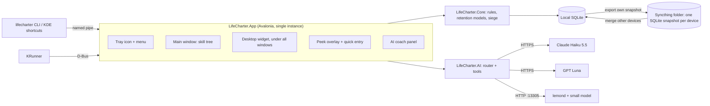

# LifeCharter — Plan

A Path-of-Exile-style passive skill tree for real life, with a daily defense game. Three attribute roots — **Health** (lifestyle), **Stamina** (exercise), **Might** (learning) — with goals planned by hand or with AI help, learning-science retention models that decide when a skill is truly learned, and fast entry from the tray, a desktop widget and global shortcuts. Runs on KDE Plasma 6 (Wayland) and Windows 11, synced through Syncthing.

Status: planning. Nothing implemented yet.

---

## 1. Technology decision

**Pick: .NET 10 + Avalonia 12.1 (C#), with SQLite. Everything is C# — no QML, HTML or JS.**

| Option | Verdict | Why |
|---|---|---|
| **Avalonia 12.1 + .NET 10** | **Chosen** | You already know it. Retained-mode UI that renders only when something changes, so it uses almost no CPU or GPU when idle. Skia drawing is good for a custom tree canvas with 1,000+ nodes. Built-in `TrayIcon` (StatusNotifierItem on KDE), frameless and transparent windows for the desktop widget, and native Wayland in 12.1. One language for UI, AI, D-Bus and Win32 interop. |
| Godot 4 | Rejected | Best for visuals, but it is built around a game loop and always holds a GPU context. Forms, text input and IME are weak for data entry. Tray support (`StatusIndicator`) is basic. |
| Electron | Rejected | 200–400 MB RAM for a tray app. |
| Tauri (web UI) | Rejected | On Linux it renders through WebKitGTK, which has known rendering and performance problems on NVIDIA + Wayland. Backend is Rust. |
| Blazor Hybrid (MAUI / Photino) | Rejected | MAUI has no Linux target. Photino uses WebKitGTK too, and its tray support is weak. |

### Core libraries

| Concern | Library |
|---|---|
| UI | `Avalonia` 12.1.x, `Avalonia.Desktop`, `Avalonia.Wayland` (`UseWaylandWithFallback()`), Fluent theme |
| MVVM | `CommunityToolkit.Mvvm` (source generators) |
| Hosting, DI, config | `Microsoft.Extensions.Hosting` |
| Logging | **Serilog** with rolling daily files (`Serilog.Sinks.File`, 14 days, 10 MB cap) in `~/.local/state/LifeCharter/logs` (Windows: `%LOCALAPPDATA%\LifeCharter\logs`). Libraries log through `ILogger<T>`, bridged by `Serilog.Extensions.Logging`; Avalonia's warnings go to the same file. |
| Storage | SQLite via `Microsoft.EntityFrameworkCore.Sqlite`; raw SQL for the sync merge |
| Spaced repetition | `FSRS.Core` (a .NET port of py-fsrs). Spike 0 confirms it implements FSRS-6; otherwise port ts-fsrs (about 300 lines). |
| AI abstraction | `Microsoft.Extensions.AI` (`IChatClient`, function invocation middleware) |
| Anthropic | Official `Anthropic` NuGet package. It ships an `IChatClient` adapter with function invocation; use its native API where prompt caching matters. |
| OpenAI + Lemonade + any OpenAI-compatible server | `OpenAI` + `Microsoft.Extensions.AI.OpenAI`, with the base URL overridden for local servers |
| Linux desktop integration | `Tmds.DBus.Protocol` (notifications, KRunner, Secret Service, GlobalShortcuts portal, KWin reconfigure) |
| Single instance + CLI | Named pipes (`System.IO.Pipes`, `PipeOptions.CurrentUserOnly`). On Linux they map to Unix domain sockets, so no HTTP server is needed. |
| Installer + auto-update | `Velopack` (Windows installer; Linux AppImage), plus an Arch `PKGBUILD` for CachyOS |
| Tests | xUnit v3 (Microsoft.Testing.Platform) + **NSubstitute** + Avalonia.Headless; year-long simulation tests for game fairness (section 5) |

Native AOT is out of scope for v1 because EF Core relies on reflection. Use ReadyToRun and partial trimming instead.

---

## 2. Architecture



- **Single instance.** Running `lifecharter quick`, `lifecharter peek` or `lifecharter log "ran 5k"` while the app is running forwards the command to it over a named pipe, then exits.
- **Main window is opened only on demand.** Closing it **disposes** the window instead of hiding it, which frees its GPU surfaces. The tray and the widget keep running at close to zero cost.

### Solution layout

Projects separate dependencies (UI, storage, OS, AI). **Inside each project the code is organised feature first**, then by layer: `Business/`, `Models/`, `Interfaces/`, `Views/`, `ViewModels/`, `Controls/`. The full rules are in [CODING_GUIDELINES.md](CODING_GUIDELINES.md).

```
LifeCharter.slnx
src/
  LifeCharter.Core/        pure domain, no UI
    Sync/                    Business/HybridLogicalClock, Models/HlcStamp
    Retention/  Siege/  Progression/  Goals/        (Phase 1–2)
  LifeCharter.Data/        SQLite
    Sync/                    Business/SnapshotSync, Models/SyncedTable, SyncKind, MergeReport
    Storage/                 (Phase 1: EF Core DbContext, migrations)
  LifeCharter.Platform/    OS integration
    AppInstance/             Business/SingleInstance (named pipe)
    DesktopWidget/           Business/KWinRuleInstaller, DesktopPinning (Windows)
    Notifications/  Secrets/  Shortcuts/  Autostart/  (Phase 3+)
  LifeCharter.AI/          providers, router, tools, quick-entry parser, Lemonade manager
  LifeCharter.App/         Avalonia
    Shell/                   Business/AppShell, AppCommands, TrayIconFactory; Models/AppCommand
    Logging/                 Business/AppLogging (Serilog), AvaloniaSerilogSink
    SkillTree/               Views/TreeWindow, Controls/SkillTreeCanvas, Business/TreeLayoutGenerator, Models/…
    Widget/                  Views/WidgetWindow, PeekWindow, WidgetContent
spikes/
  LifeCharter.AiSpike/     provider tool-call spike (Phase 0)
tests/                     mirror the src folders
  LifeCharter.Core.Tests/  Sync/Business/HybridLogicalClockTests, Retention/Business/FsrsSpikeTests
  LifeCharter.Data.Tests/  Sync/Business/SnapshotSyncTests
docs/
```

---

## 3. Domain model

### Entities

Every synced table has `Id` (UUIDv7), `UpdatedAt` (hybrid logical clock, HLC), `DeletedAt` (tombstone) and `DeviceId`. These columns are what make the merge in section 9 possible.

| Entity | Key fields |
|---|---|
| `Node` | Attribute (Health/Stamina/Might), Kind (Root, Small, Notable, Keystone, Socket), Title, Description, Icon, Position, **RetentionModel** (Memory, Habit, Capacity, MotorSkill, Milestone), Complexity (simple/standard/complex), XpReward |
| `Edge` | From, To, Kind (`Path`: any allocated neighbour unlocks it; `Requires`: every prerequisite must be mastered) |
| `Goal` | NodeId, Metric (Count, Sum, Streak, Duration, Milestone), Target, Unit, Window (Total, Daily, Weekly), Start, Deadline?, Source (Manual, AI) |
| `Quest` | GoalId?, Title, Schedule (once, daily, weekdays, N× per week, RRULE), Amount, Unit, **Cue** ("When/where…, I will…"), Aliases |
| `LogEntry` (append-only) | Timestamp, NodeId?, QuestId?, Amount, Unit, Note, Source (Tray, Widget, KRunner, CLI, Chat) |
| `Review` (append-only) | NodeId, Timestamp, Rating (Again/Hard/Good/Easy) — a recall session on a Memory node |
| `HabitCheck` (append-only) | NodeId, Timestamp, SRBAI answers (4 × 1–5) |
| `Allocation` / `WardUse` / `DraftDecision` (append-only) | Game and AI actions |
| `SyncedSetting` | Key, Value (difficulty, budget, rollover time, timezone, …) |

**Derived state is never stored as truth:** XP, levels, node states, integrity, siege results and FSRS memory state are recomputed from the append-only tables plus settings (cached locally). Both devices therefore always compute the same result, and nothing gets counted twice after a sync.

### Node lifecycle

```
Locked → Available → Training → Mastered → Fortified → Engraved
                        └──────────┴───────────┴──→ Corrupted → (cleanse) → previous state
```

| State | Meaning | Attackable |
|---|---|---|
| Training | Allocated with a skill point; goal in progress | Yes (soft) |
| Mastered | Goal reached; retention phase begins | Yes |
| Fortified | About halfway to permanent (section 4) | Rarely |
| **Engraved** | **Learned permanently (section 4).** Gold rim, immune to attacks. | **No** |
| Corrupted | Integrity reached 0. Dimmed, its stat bonus is off, history is kept. | — |

### Progression rules

1. **Doing things earns XP**, with a daily XP cap per quest, so spamming one easy habit does not pay.
2. **Levels earn skill points.** The XP curve starts at about `100 × level^1.5`; each level grants 1 point.
3. **Spending a point allocates a node** (PoE path rule or `Requires` edges), which commits you to its goal.
4. **Work-in-progress limit:** at most 3 nodes in Training per attribute (configurable).
5. **Shame-free respec:** abandoning a goal refunds its point.
6. **Sockets** hold time-boxed challenges (for example 30 days of cold showers).
7. **Starter template** (seed): Health — Sleep, Hydration, Nutrition, Mind, Screen time, Social. Stamina — Cardio, Strength, Mobility, Steps, Sport. Might — Languages, Programming, Reading, Courses, Creative. A manual wizard or a short AI interview turns it into your first 30–45 nodes.

---

## 4. Learning science: when is a skill "learned"?

Each node has a **retention model** that matches what kind of thing it is. The model decides when the node is attacked, how fast it fades, and when it becomes **Engraved** (permanent and immune). Defaults are set per attribute and can be changed per node.

| Model | Used for (default) | Evidence | What fades and triggers attacks | **Engraved when** |
|---|---|---|---|---|
| **Memory** | Knowledge: languages, programming, theory (Might) | Forgetting curve and spacing effect (Ebbinghaus; Cepeda 2006 meta-analysis); testing effect (Roediger & Karpicke 2006); FSRS memory model | Predicted recall probability *R* falls over time. The node is attacked when *R* drops below the desired retention (default 0.90) — that is, when a review is due. | **Stability ≥ 365 days**, meaning ≥ 90% predicted recall after a year without practice, **and ≥ 5 successful reviews spanning ≥ 6 months**. Phase 0 measured FSRS-6: all-Good reviews reach it in 6 reviews over 289 days; all-Easy would reach it in only 3 reviews, hence the extra guard. **Fortified** at stability ≥ 90 days. |
| **Habit** | Lifestyle behaviours (Health) | Automaticity grows along an asymptotic curve with repetitions in a stable context: median 66 days, range 18–254, and a single missed day did not derail it (Lally 2010). Implementation intentions (Gollwitzer & Sheeran 2006, d ≈ 0.65). | Missed scheduled repetitions. Modelled automaticity `A(n) = 1 − e^(−k·n)`, where each miss costs a little. | **A ≥ 95% of plateau** (default 66 performed repetitions; simple habits ×0.5, complex ×2) **and** an SRBAI self-check (4 questions, Gardner 2012) averaging ≥ 4/5. **Fortified** at A ≥ 70%. |
| **Capacity** | Fitness levels: endurance, strength (Stamina) | Detraining and minimal maintenance dose (Spiering 2021): endurance held up to 15 weeks at 2 sessions/week, or with 33–66% less volume, if intensity stays the same; strength held up to 32 weeks at 1 session/week and 1 set per exercise at the same relative load. | Missing the weekly maintenance dose, after a 14-day grace period (when detraining starts). | **Never fully immune**, because physiology isn't. **Seasoned** (the Capacity version of Fortified) after 6 months at ≥ 80% weekly adherence: only the maintenance dose is needed to defend, and damage is halved. |
| **Motor skill** | Technique: swimming crawl, touch typing, juggling | Physical, closed-loop skills decay much more slowly than cognitive ones (Arthur 1998 meta-analysis on skill decay). | Memory model with a high starting stability. | A proficiency test passed, plus practice in ≥ 4 spaced sessions over ≥ 4 weeks. |
| **Milestone** | One-off achievements (ran a marathon) | — | Nothing | When completed. It happened. |

Each node shows its **Engrave progress**, for example "stability 41 / 365 days · 4 of ~7 reviews · estimated Aug 2027". You always know how much practice is left before a skill is permanent.

### Techniques built into quests (not only into scheduling)

| Technique | How LifeCharter uses it |
|---|---|
| Retrieval practice | Defending a Memory node means **recalling first** (blank page, self-quiz, explaining it aloud), then checking and rating Again/Hard/Good/Easy. Re-reading does not count as a defense. |
| Spacing | The FSRS scheduler sets when each node is attacked |
| Interleaving (Rohrer & Taylor 2007) | The daily defense list mixes topics instead of grouping them |
| Desirable difficulties (Bjork 1994) | A hard but successful recall raises stability more (built into FSRS) |
| Deliberate practice (Ericsson 1993) | Practice-session template: one specific weakness, immediate feedback, a short note |
| Implementation intentions | Every habit quest has a cue: "When/where …, I will …" |
| Savings effect (Ebbinghaus) | Relearning is faster than learning, so a corrupted node is restored with a short cleanse quest |
| Progressive overload, then maintenance | Capacity nodes grow during Training and switch to the minimal maintenance dose once Mastered |

Caveat: FSRS was designed for flashcards. Applying it to a whole node (one review = one recall session on that topic) is an approximation. Later, optional per-item cards and import from Anki can refine it.

---

## 5. The daily siege (game layer)

Each day at rollover (default 04:00, in a timezone stored in the synced settings), **Entropy** attacks your tree. The attacks are not random: they come from the retention models in section 4. An attack on a node means *this is what you would actually start forgetting or losing today*. Defending it means doing the practice that prevents that.

### Daily loop

1. **Morning threat report** (notification + widget): today's attacked nodes, most dangerous first, with an estimate of the time needed to defend them all.
2. **Defend during the day** with one tap in the widget, tray or quick-entry bar. A Habit node is done/not done. A Capacity node needs a logged workout that meets the maintenance dose. A Memory node opens a short recall dialog: recall first, then rate.
3. **Siege resolves at rollover.** Undefended attacks deal damage to the node's **integrity** (0–100 HP). Defended nodes recover to full and grow stronger, because a successful defense is a review.

### Making it configurable

| Setting | What it does |
|---|---|
| **Daily defense budget** | Maximum attacks per day, or minutes per day (estimated time per node). The scheduler never schedules more than this and spreads due items across days, as Anki's load balancer does. **Only scheduled attacks can deal damage**, so something the scheduler postponed because of your budget never hurts you. |
| Rest days | Weekdays with no attacks. Their load is moved to the days around them. |
| Difficulty preset | Sets the knobs below. Every knob can also be changed on its own. |

| Preset | Damage × | Attacks/day | Rest days/week | Ward cap | When integrity hits 0 |
|---|---|---|---|---|---|
| Peaceful | 0 (fading shown only visually) | — | — | — | Nothing |
| Casual | 0.5 | 3 | 2 | 5 | Node dims |
| **Standard** (default) | 1.0 | 6 | 1 | 3 | Node is Corrupted: dims, its stat bonus is off |
| Hardcore | 1.5 | 10 | 0 | 1 | Node is un-allocated (point refunded); mastery must be re-earned through the cleanse quest |

**Damage** is about 20 HP × severity × difficulty multiplier. Severity grows the more overdue a node is (Memory: how far *R* is below target; Habit: consecutive misses; Capacity: days past the grace period). On Standard, about 5 undefended days in a row corrupt a node. The exact curves are tuned in Phase 2 with simulation tests.

### More game elements

- **Wards:** earn 1 for every 7 fully defended days. Spend one to shield an entire day (illness, travel).
- **Vacation mode:** pauses the siege for N days. Forgetting doesn't pause in reality, so on return the scheduler front-loads a recovery plan, spread over several days within your budget.
- **Bosses (the testing effect):** a weekly or monthly challenge per attribute. Might: a cumulative self-test across many nodes. Stamina: a benchmark such as a 5 km time trial or max push-ups. Health: a perfect habit week or the SRBAI check. Winning gives a lot of XP, a ward, and a stability bonus, because a passed test counts as a review.
- **Defense streak** and personal best. A day protected by a ward does not break the streak.
- **Cleanse quests** restore corrupted nodes. They are shorter than the original goal (savings effect).

### Fairness tests (acceptance criteria)

Simulate a year for these behaviour profiles and check the outcome on Standard:
- 80% adherence never corrupts a node.
- A 2-week vacation with wards or vacation mode loses nothing permanent.
- Training only on weekends survives with 2 rest days configured.
- Perfect adherence engraves a Memory node within about 12 months and a standard Habit node within about 3 months.

Siege results are a **pure function** of history + settings + date. Both devices compute identical outcomes, with nothing to sync and nothing resolved twice.

---

## 6. Skill tree UI, animation and energy budget

### Layout

- Radial layout. The character sits at the centre, and each attribute gets a 120° sector. Proposed colours: Stamina red, Health green, Might blue.
- **Edit mode:** drag nodes, snap to a polar grid, Shift-drag to connect two nodes, side inspector panel.
- Nodes generated by the AI are auto-placed once inside their parent's sector, then you can adjust them.

### Rendering (`SkillTreeCanvas`)

- Draws through `DrawingContext` / Skia, with pan and zoom as one matrix transform.
- **Two layers:** the static layer (edges, locked nodes, background) is cached as a bitmap; a small dynamic layer holds hovered, animating and attacked nodes.
- Viewport culling with a spatial grid. Level of detail: below 0.4× zoom, nodes become dots and labels are hidden.
- Node decorations: a progress ring (Training), cracks in proportion to lost integrity (under attack), a pale rim (Fortified), a gold rim (Engraved), dimmed with a dark vein (Corrupted).

### Animations

| Animation | Trigger | Cost |
|---|---|---|
| Light flowing along an edge | Node allocated | ≤ 800 ms, then stops |
| Shield flash, cracks closing | Node defended | ≤ 600 ms |
| Impact shake + crack | Siege resolution, shown the next time you open the tree | ≤ 800 ms per node, played in sequence, skippable |
| Gold engraving sweep | Node Engraved | ≤ 1.2 s |
| XP bar easing, level-up overlay | Log entry, level-up | Short, then stops |
| Soft pulse on available and attacked nodes | Ambient | Only while the window is visible and focused, capped at 30 fps, off in Eco mode |

### Energy rules (acceptance criteria)

- No permanent render loop. Frames are drawn only on input, data change or a running time-limited animation.
- Eco mode (default when on battery) disables ambient effects.
- **Targets on the RTX 5070 Ti machine:** tray + widget idle < 0.5% CPU, no GPU work, < 150 MB RAM. Panning a 1,000-node tree at 60 fps with < 10% GPU load. Local model unloaded after 10 min without AI use.
- Measure with `nvidia-smi dmon`, `powertop` and the Windows Task Manager GPU column. Add a developer overlay that shows FPS and frames drawn.

---

## 7. AI assistant

### 7.1 Providers

All providers sit behind one `IChatClient` pipeline (`ChatClientBuilder().UseFunctionInvocation().UseLogging()`).

| Profile | Endpoint | Default model | Notes |
|---|---|---|---|
| Anthropic | api.anthropic.com | `claude-haiku-5-5` | $0.10 / $0.50 per 1M tokens (input/output). Defaults to adaptive thinking at effort `medium`; use `low` for chat and quick tasks. |
| OpenAI | api.openai.com | `gpt-6-luna` (also `gpt-5.6-luna`) | Third-party listings disagree on Luna's pricing and availability. Fill the model dropdown from `/v1/models` instead of hardcoding it. |
| Local (Lemonade) | `http://localhost:13305/api/v1` | auto-selected (7.4) | OpenAI-compatible. Free and private. |
| Custom | any OpenAI-compatible URL | user-defined | Ollama, LM Studio, and so on |

- API keys are stored in the OS keychain (KWallet through the Secret Service D-Bus API on Linux; DPAPI / Credential Manager on Windows). They are never written to SQLite, so they are never synced.
- A **Local only** privacy switch disables every cloud profile.

### 7.2 Routing by task

| Task | Default route | Why |
|---|---|---|
| Natural-language quick entry ("ran 5k in 28 min", "přečetl jsem 30 stran") | Local model with thinking off and JSON-schema output | Under ~1 s, free, private |
| Coach chat | Your choice. Haiku if a key is set, otherwise local. | |
| Goal planning / branch generation | Haiku 5.5 or GPT-6 Luna; local Qwen3.5-9B as offline fallback | Planning quality matters most here |
| Weekly review and replanning | Cloud, once a week | A few cents per month |

### 7.3 Tools the model can call

The model never writes to the database directly. Every tool that would change data returns a **draft**: ghost nodes on the tree or a diff, which you Accept, Edit or Reject.

- Read: `get_overview()`, `search_nodes(query)`, `get_node(id)`, `get_logs(range, attribute?)`, `get_adherence(goalId)`, `get_siege_report(date)`, `get_engrave_progress(nodeId)`
- Draft: `propose_branch(parentNodeId, nodes[], edges[], goals[], quests[])`, `propose_log(entries[])`, `propose_adjustment(goalId, changes, reason)`, `propose_reminder(questId, schedule)`

**Goal planning flow:** you state an objective → the AI asks 2–3 clarifying questions → it proposes a branch. Each node in the branch gets a **retention model**, SMART targets, weekly quests with cues, and an estimated time to Engrave. The branch appears as ghost nodes → you accept.

**Dynamic replanning:** every Sunday, the AI reads adherence and siege history. When you fall behind, it proposes concrete changes (lower the daily budget, add a rest day, extend a deadline, split a node). It never applies them silently.

**Language:** the AI replies in the language you write in. The UI is localised (Czech and English) with `.resx` resources.

### 7.4 Local models (bundled Lemonade)

Installed here: `lemonade-server 2026.43.3` (`lemond`, port 13305, `max_loaded_models: 1`). Candidates come from Lemonade's model registry (Q4 quantised sizes).

| Role | Lemonade model | Size | Why |
|---|---|---|---|
| **Default** | `Qwen3.5-4B-GGUF` | 3.6 GB | Tool calling, 201 languages including Czech, 262K context, vision |
| Speed variant to test | `Qwen3.5-4B-MTP-GGUF` | 3.7 GB | Multi-token prediction decodes faster; adopt it if the eval confirms |
| Multilingual alternative | `Gemma-4-E4B-it-GGUF` | 6.0 GB | 140+ languages, native function calling, often more natural Czech prose |
| Light / CPU-only | `Qwen3-4B-Instruct-2507-GGUF` | 2.5 GB | Non-thinking model with reliable tool calls |
| Optional offline planner | `Qwen3.5-9B-GGUF` | 6.9 GB | Above the 7B budget, but fits easily in 16 GB VRAM; best local planner |
| Ruled out | Phi-4-mini, Llama-3.2-3B, SmolLM3-3B, Ministral-3-3B, granite-4.0-h-tiny | — | No tool-calling label in the registry, weaker multilingual support, or far fewer languages |

**Selection logic:** read the hardware from Lemonade's system info. With ≥ 6 GB VRAM choose `Qwen3.5-4B`; on CPU only choose `Qwen3-4B-Instruct-2507`. The eval harness confirms the choice, and Settings allows a manual override.

**Eval harness:** 40 quick-entry phrases (20 Czech, 20 English) → expected structured entry (exact match); 10 planning prompts → rate of valid tool calls plus a quality score from a rubric; latency, tokens per second, VRAM, GPU power (W).

**Lifecycle:**
- If `lemond` is not reachable, start it: `systemctl --user start lemond` on Linux, or the bundled `lemond` as a child process on Windows.
- Load the model on first AI request; unload it after 10 min idle.
- Thinking off for quick entry; prefer JSON-schema constrained output over free-form tool calls on small models; validate the result and retry once on failure.

**Bundling:** on Linux, depend on the `lemonade-server` package. On Windows, the installer sets Lemonade up silently if it is missing, or ships a portable `lemond`. Check Lemonade's licence before redistributing it.

---

## 8. Fast entry: tray, desktop widget, shortcuts

### Tray

The menu contains: **Open tree** · **Peek widget** · **Quick entry** · **Today's defenses** (checkable items, one click defends a node) · **Coach** · **Pause reminders** · **Quit**. The tray icon shows a small ring for today's defense progress and turns red while attacks are undefended in the evening.

### Desktop widget (Avalonia, both OSes)

One Avalonia window: frameless, transparent, no taskbar or Alt-Tab entry, on all virtual desktops, at a remembered position, **always under all other windows**. Contents: level ring, 3 attribute bars, today's threats (tap to defend), a quick-entry field, an "Open tree" button. Layouts: compact, threats and full; several widgets can be open at once.

**Keeping it under all windows:**

| OS | How |
|---|---|
| **KDE Plasma (Wayland)** | Wayland does not let an app set its own stacking order or position. On first run the app therefore installs a **KWin window rule** — plain config, no scripting. The rule matches the window title `LifeCharter Widget` and forces: keep below, skip taskbar/pager/switcher, all desktops, no border, remembered position. The app writes it to `~/.config/kwinrulesrc` and tells KWin to reload its config over D-Bus. Spike 0 confirms the exact rule keys. |
| KDE fallback | Run the Linux build on Avalonia's X11 backend (XWayland) and set `_NET_WM_STATE_BELOW` and skip-taskbar directly via Xlib on the window handle |
| **Windows 11** | `WS_EX_TOOLWINDOW` (no taskbar/Alt-Tab) + `WS_EX_NOACTIVATE`, kept at `HWND_BOTTOM` (re-applied in `WM_WINDOWPOSCHANGING`). To survive `Win+D`, attach the window to the desktop window (Progman/WorkerW), as Rainmeter's "On desktop" mode does. Spike 0 checks this. |

**Showing it:**
- **Show desktop:** KDE `Meta+D` (Peek at Desktop) and Windows `Win+D` reveal the widget.
- **Peek shortcut** (default `Meta+Shift+W`, configurable): the widget's content appears in an **on-top overlay window** at the same position, fully interactive. Esc or clicking elsewhere hides it. The overlay is a separate window without the keep-below rule. Only the overlay plays animations; the widget under all windows stays static, so it costs nothing while hidden.

### Quick-entry bar

A Spotlight-style popup (default `Meta+Shift+Space`):

1. Type `run 5`, `water 2l` or `read 30` → a deterministic parser matches quest **aliases** first. This is instant and needs no AI.
2. Anything else goes to the local model → a preview chip such as `Stamina › Running · 5 km · defends "Cardio I" · +50 XP` appears → **Enter** confirms.
3. Slash commands: `/log`, `/defend`, `/goal`, `/plan`, `/today`, `/undo`, `/coach`.

### Global shortcuts

| OS | How |
|---|---|
| KDE | XDG GlobalShortcuts portal, or KDE custom shortcuts that run `lifecharter peek` / `lifecharter quick`. `Meta+L` is already the lock screen, so it is not used. |
| Windows | `RegisterHotKey` via P/Invoke |

### More entry points

- **KRunner** (KDE): a D-Bus runner implemented in C#. `Alt+Space` → `lc ran 5k` → logged.
- **Notifications:** `org.freedesktop.Notifications` on KDE and toasts on Windows, with **Defend** and **Snooze** actions.
- Later, optional: Windows 11 Widgets Board provider, PowerToys Command Palette extension.

---

## 9. Storage and Syncthing sync

### Why the app doesn't simply put its database in the Syncthing folder

Syncthing syncs **files**, not database contents. A live SQLite file in a synced folder fails in three ways:

1. **WAL mode** keeps `-wal` and `-shm` files next to the database. Syncthing copies them separately, so the other machine can receive a database without its matching WAL → missing data or corruption.
2. **Open file:** Syncthing replaces the file while the app has it open. On Linux the app keeps writing to the old copy; on Windows the file is locked and sync stalls.
3. **Edits on both machines** between syncs → Syncthing keeps one whole file and renames the other to `.sync-conflict-…`. One side's changes are lost; nothing is merged.

### Design: SQLite everywhere, one snapshot per device, merged row by row

```
~/.local/share/LifeCharter/lifecharter.db      ← working database (WAL), never synced
                                                  Windows: %LOCALAPPDATA%\LifeCharter\

~/Sync/LifeCharter/                            ← Syncthing-shared folder (path configurable)
  devices/
    0193a7…-cachyos.db                         ← written ONLY by the Linux install
    0193b2…-windows.db                         ← written ONLY by the Windows install
  .stignore                                    ← *.tmp
```

1. **Export:** 30 s after the last change, and on exit and suspend, the app runs `VACUUM INTO 'devices/<id>.db.tmp'` and then renames the file to `<id>.db`. The rename is atomic, so Syncthing only ever sees complete files.
2. **Import:** a `FileSystemWatcher` on `devices/`, plus a check at startup and after resume. For each other device's file that is newer than the last merge, the app copies it to a temp file (so Syncthing is never blocked by a lock), `ATTACH`es it, and merges it in one transaction.
3. **Merge rules:**
   - Append-only tables (`LogEntry`, `Review`, `HabitCheck`, `Allocation`, `WardUse`, …): `INSERT OR IGNORE` by `Id`.
   - Mutable tables (`Node`, `Edge`, `Goal`, `Quest`, `SyncedSetting`): the row with the newer HLC `UpdatedAt` wins (ties broken by `DeviceId`).
   - Deletions are tombstones (`DeletedAt`), purged after 90 days.
4. Each snapshot contains everything its device has merged, so changes also spread through a third device.

**Results:**
- **Every file has exactly one writer**, so Syncthing never creates conflict copies.
- Edits made offline on both machines all survive.
- Because derived state is recomputed (section 3), XP and siege results come out identical on both machines.

**Never synced:** API keys (keychain), device ID, window positions, per-device provider choice.

| | Linux | Windows |
|---|---|---|
| Working DB | `~/.local/share/LifeCharter/` | `%LOCALAPPDATA%\LifeCharter\` |
| Device config | `~/.config/LifeCharter/device.json` | `%APPDATA%\LifeCharter\device.json` |
| Sync folder | configurable, e.g. `~/Sync/LifeCharter` | configurable |
| Syncthing | installed (v2.1.7, service currently inactive) → `systemctl --user enable --now syncthing` | Syncthing for Windows |
| Autostart | `~/.config/autostart/lifecharter.desktop` | `HKCU\...\Run` |
| Backup | Daily rolling copy (keep 14) + JSON export | same |

**Setup: two machines** (KDE desktop and Windows) paired directly as Syncthing peers. Snapshots sync whenever both are online. Changes made while one machine is off are merged the next time they connect, and because each snapshot has a single writer, nothing is lost in between. Adding a third peer later (NAS, phone) needs no app changes.

---

## 10. Milestones

| # | Phase | Deliverables | Exit criteria |
|---|---|---|---|
| 0 | **Spikes** | (a) Avalonia tray + desktop widget: KWin rule for keep-below on Plasma 6.8 Wayland; `HWND_BOTTOM` + desktop attachment surviving `Win+D` on Windows; Peek overlay via shortcut. (b) `SkillTreeCanvas` with 1,000 dummy nodes. (c) Lemonade: Qwen3.5-4B tool call through the OpenAI SDK; confirm endpoint paths and the thinking switch. (d) Haiku and Luna tool calls through `IChatClient`. (e) `FSRS.Core` FSRS-6 check. (f) Snapshot export + `ATTACH` merge between two folders. | Energy numbers from section 6 met; widget stays below windows on both OSes; merge test passes |
| 1 | **Core MVP** | Domain + SQLite with sync columns from day one, manual tree editor, goals, quests, log entries, XP and levels, tray + main window | One full week of real use |
| 2 | **Retention + siege** | Memory/Habit/Capacity/MotorSkill/Milestone models, Engrave progress, daily siege, budget scheduler, rest days, difficulty presets, wards, vacation mode, cleanse, fairness simulations | All fairness tests pass; two weeks of real use feels motivating, not punishing |
| 3 | **Daily use on both OSes** | Desktop widget + Peek, quick-entry bar, alias parser, global shortcuts, tray defense list, notifications, CLI, **Syncthing sync** | Defending a node takes ≤ 3 s from anywhere; a week of use across Linux and Windows with no lost entries |
| 4 | **Tree polish** | Radial layout, node decorations, animations, LOD, Eco mode, bosses | Energy targets still met |
| 5 | **AI** | Provider settings + keychain, coach chat, natural-language quick entry, goal planning with ghost nodes and retention models, weekly replanning, eval harness, model auto-selection | ≥ 90% accuracy on the quick-entry eval |
| 6 | **Packaging + integrations** | Velopack (Windows) + PKGBUILD/AppImage (Linux), Lemonade bootstrap, first-run model download, KRunner, autostart | Clean install on a fresh Windows VM and on CachyOS |
| 7 | Later | Per-item flashcards + Anki import, stats dashboard, achievements, imports (Strava, Google Fit, Health Connect), Windows Widgets Board | — |

---

### Phase 0 results (2026-11-17, branch `phase0/spikes`)

| Spike | Result |
|---|---|
| (a) Tray + desktop widget (KDE) | ✅ Tray icon, frameless transparent widget, Peek overlay, single instance over a named pipe (a second launch forwards its command and exits in 0.1 s). A KWin rule matched by the widget's own Wayland app id (`lifecharter-widget`) gives keep-below, skip taskbar/switcher, all desktops, no border. Plasma 6.8 stores the rule list in `General/Order`. Matching by title did **not** work, because the title arrives after the window maps. ⚠️ The initial position from the rule is not applied yet. |
| (a) Windows | ⬜ Code written (`WS_EX_TOOLWINDOW`, `HWND_BOTTOM`, `WM_WINDOWPOSCHANGING` hook); not run. Surviving `Win+D` still open. |
| (b) Tree canvas, 1,000 nodes | ✅ Renders on demand: 1 frame at open, then **0 frames while idle**. Pan, zoom, culling, level of detail, click-to-allocate with pulse animation. ⬜ Panning FPS and GPU load need a manual check (overlay shows frames/s). |
| Energy, tray + widget idle | ✅ 0–0.5% CPU, 0% GPU (15 MB VRAM), PSS 116 MB / RSS 211 MB (Debug build; RSS counts shared NVIDIA libraries) |
| (c) Lemonade tool call | ⬜ Spike console ready (`spikes/LifeCharter.AiSpike`); needs `lemond` running and the 3.6 GB model downloaded |
| (d) Haiku / Luna tool calls | ⬜ Same console; needs `ANTHROPIC_API_KEY` / `OPENAI_API_KEY` |
| (e) FSRS | ✅ `FSRS.Core` 1.0.7 implements FSRS-6 (21 weights). All-Good reviews reach Engraved in 6 reviews over 289 days, so a minimum-review guard was added (section 4). |
| (f) Snapshot sync | ✅ 6 tests: offline edits on both devices converge, last writer wins, tombstones propagate, idempotent merge, atomic export |
| Bug found and fixed | Quitting deadlocked: the pipe listener captured the UI synchronization context while the UI thread blocked on it. Led to the async rules in CODING_GUIDELINES.md. |

---

## 11. Risks

| Risk | Mitigation |
|---|---|
| The siege feels punishing and demotivates you | Budget cap, rest days, wards, vacation mode, Peaceful/Casual presets, fairness simulations as acceptance tests, "only scheduled attacks deal damage" rule |
| Wayland blocks keep-below or positioning for the widget | KWin window rule; X11 backend fallback; Peek overlay works regardless |
| Windows `Win+D` hides the widget | Desktop (Progman/WorkerW) attachment; Peek shortcut as fallback |
| Merge bugs lose or duplicate data | Append-only tables, idempotent inserts, two-device merge tests, daily backups |
| FSRS applied at node level is coarse | Desired retention is configurable; per-item cards later |
| Small models produce malformed tool calls | Deterministic parser first, JSON-schema output, validation and retry, every change shown as a draft |
| Animations gradually increase GPU use | Energy targets as acceptance tests; FPS overlay; no render loop |
| Scope creep (it is a game) | Ship Phase 1, use it for a week, then add the siege |

---

## 12. Open questions

1. Rollover time: is 04:00 good?
2. Default difficulty: Standard, or start on Casual for the first month?
3. UI language: Czech + English, or English only?
4. Attribute colours and names final (Health/Stamina/Might → green/red/blue)?

Resolved: two separate machines, synced peer-to-peer through Syncthing (section 9).

---

## References

- Arthur, W. et al. (1998). Factors that influence skill decay and retention: a quantitative review. *Human Performance* 11(1).
- Bjork, R. A. (1994). Memory and metamemory considerations in the training of human beings.
- Cepeda, N. J. et al. (2006). Distributed practice in verbal recall tasks: a review and quantitative synthesis. *Psychological Bulletin* 132(3).
- Ericsson, K. A., Krampe, R. T., Tesch-Römer, C. (1993). The role of deliberate practice in the acquisition of expert performance. *Psychological Review* 100(3).
- Gardner, B. et al. (2012). Towards parsimony in habit measurement: the Self-Report Behavioural Automaticity Index. *IJBNPA* 9:102.
- Gollwitzer, P. M., Sheeran, P. (2006). Implementation intentions and goal achievement: a meta-analysis. *Advances in Experimental Social Psychology* 38.
- Lally, P. et al. (2010). How are habits formed: modelling habit formation in the real world. *European Journal of Social Psychology* 40(6).
- Roediger, H. L., Karpicke, J. D. (2006). Test-enhanced learning. *Psychological Science* 17(3).
- Rohrer, D., Taylor, K. (2007). The shuffling of mathematics problems improves learning. *Instructional Science* 35.
- Spiering, B. A. et al. (2021). Maintaining physical performance: the minimal dose of exercise needed to preserve endurance and strength over time. *J Strength Cond Res* 35(5). [PubMed 33629972](https://pubmed.ncbi.nlm.nih.gov/33629972)
- FSRS: [open-spaced-repetition algorithm notes](https://expertium.github.io/Algorithm.html), [FSRS.Core on NuGet](https://www.nuget.org/packages/FSRS.Core)
